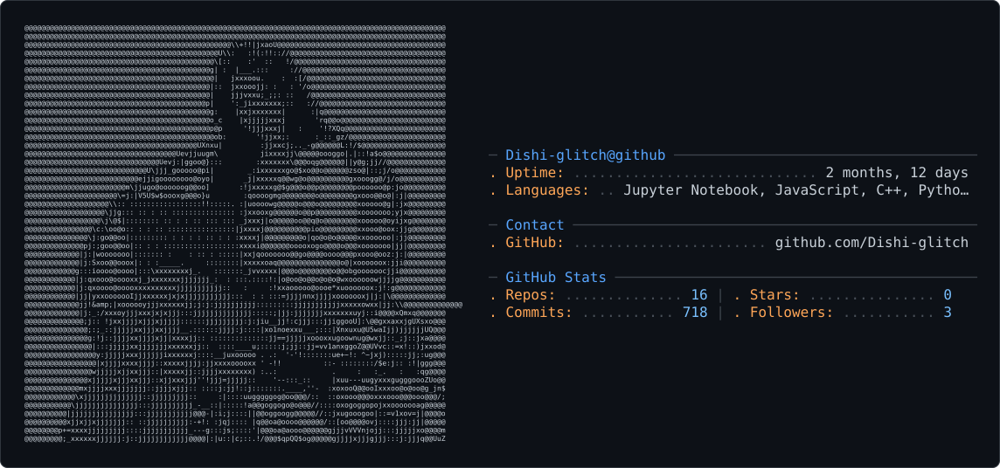

 <picture>
  <source media="(prefers-color-scheme: dark)" srcset="dark_mode.svg" />
  <source media="(prefers-color-scheme: light)" srcset="light_mode.svg" />
  
</picture>

# 🤖 AI / ML & Agentic AI

# 📊 Data Science & Machine Learning

# 💻 Programming Languages

# 🛠️ Tools & Development

# 🌐 Web Development

---

# 📊 GitHub Stats

  

<!-- Snake Game Repo View -->

  

## 🌐 Socials

  
  
  

